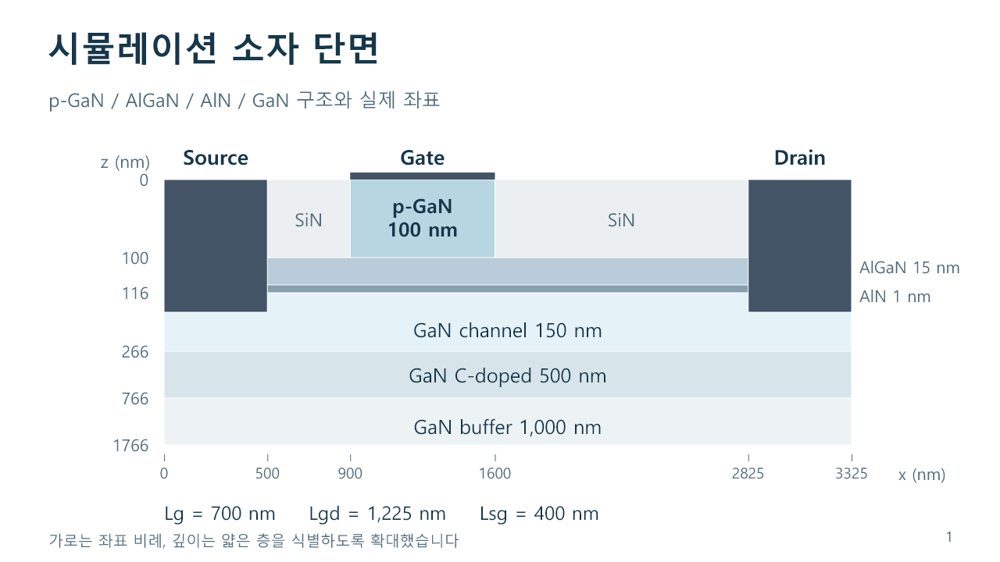
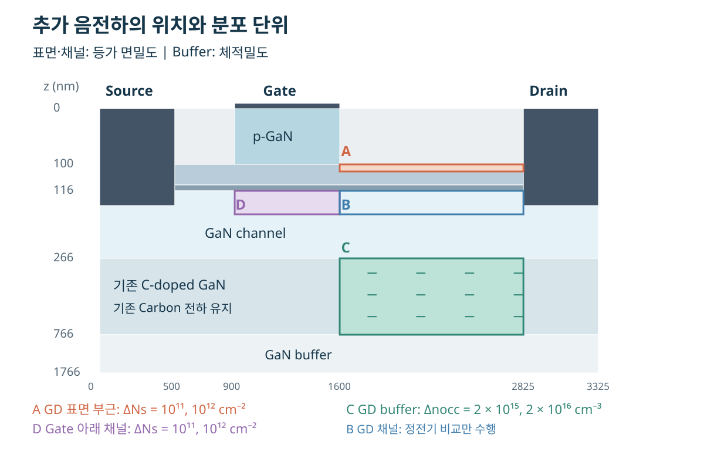
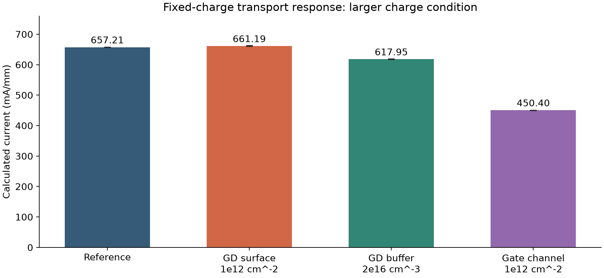
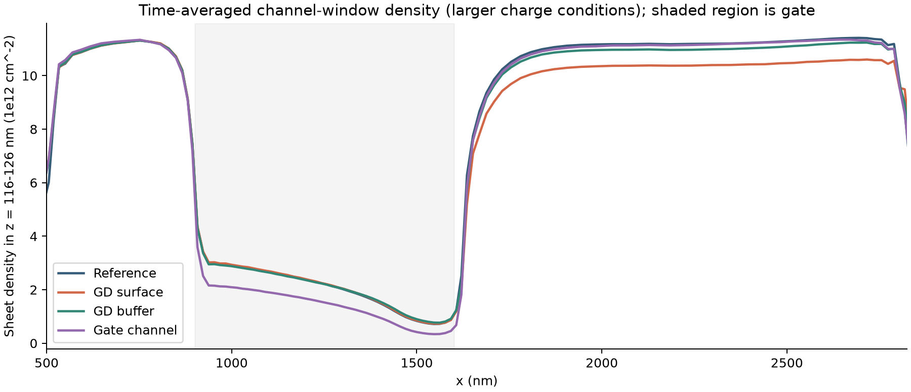
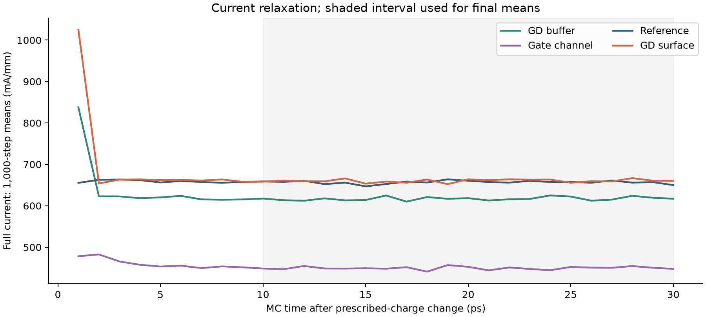

```{=html}
<nav aria-label="Fixed Charge 목차"><p><a href="#key-results">핵심 결과</a> · <a href="#structure">구조와 전하 위치</a> · <a href="#normalization">비교 기준</a> · <a href="#conditions">계산 조건</a> · <a href="#current">전류 결과</a> · <a href="#mechanism">물리적 해석</a> · <a href="#hardwall">Hard wall 확인</a> · <a href="#limits">해석의 한계</a> · <a href="#references">참고 문헌</a> · <a href="#next">후속 연구</a></p></nav>

<section id="key-results" style="scroll-margin-top:90px"><h2>핵심 결과</h2><p>기존 Monte Carlo 수송 모델에 추가 음전하를 고정해 두고, 전하의 위치와 양에 따라 전류가 어떻게 달라지는지 비교했습니다. Gate 아래 채널과 GD buffer에서 전류 감소가 관찰되어, 고정 전하를 이용한 수송 연구를 확장할 근거를 얻었습니다.</p><ul><li><strong>Gate 아래 채널:</strong> 등가 면밀도 10¹¹, 10¹² cm⁻²에서 전류가 각각 약 3.12%, 31.47% 감소합니다.</li><li><strong>GD buffer:</strong> 체적밀도 2 × 10¹⁶ cm⁻³에서 약 5.97% 감소합니다. 2 × 10¹⁵ cm⁻³의 0.37%는 평균 구간 drift와 비슷한 규모입니다.</li><li><strong>GD 표면 부근:</strong> 전류 변화는 1% 이내입니다.</li><li><strong>정공 hard wall:</strong> 안정화 후 wall을 꺼도 Gate 전하에 의한 전류 감소율은 31.45% → 32.41%로 같은 방향을 유지합니다.</li></ul><p>이 페이지는 지정한 점유 전하의 정전기적 수송 영향을 평가합니다. 실제 trap의 포획·방출, 시간상수 또는 실측 특성의 재현은 연구 범위에 포함하지 않습니다. 기본 구조와 시뮬레이터 설명은 <a href="results.html">Results</a>와 <a href="simulator.html">Simulator</a>를 참고하십시오.</p></section>

<section id="structure" style="scroll-margin-top:90px"><h2>소자 구조와 전하를 넣은 위치</h2><figure class="figure" style="display:block;margin:1.5rem 0"><a href="images/fixed-charge/device-structure.png"></a><figcaption class="figure-caption">Figure 1. 시뮬레이션 소자 단면. 가로는 좌표에 비례하고 깊이는 얇은 층을 구분하도록 확대했습니다.</figcaption></figure><figure class="figure" style="display:block;margin:1.5rem 0"><a href="images/fixed-charge/charge-locations.svg"></a><figcaption class="figure-caption">Figure 2. 추가 음전하를 넣은 A·B·C·D 영역. 그림을 누르면 원본 크기로 볼 수 있습니다.</figcaption></figure><p>깊이 z는 소자 상단에서 아래 방향입니다. GD buffer 조건은 기존 C-doped GaN 층의 GD 부분에 해당합니다. Gate 조건은 p-GaN/금속 계면이 아니라 Gate 아래 GaN 채널 내부입니다.</p><div style="overflow-x:auto"><table class="table"><thead><tr><th>영역과 위치</th><th>x 선택 구간 (nm)</th><th>z 선택 구간 (nm)</th><th>실제 셀 두께 (nm)</th><th>분석 범위</th></tr></thead><tbody><tr><td>A 영역 · GD 표면 부근</td><td>1,600–2,825</td><td>100–102</td><td>1.50</td><td>Poisson + MC 수송</td></tr><tr><td>B 영역 · GD 채널</td><td>1,600–2,825</td><td>116–126</td><td>9.76</td><td>Poisson 정전기만</td></tr><tr><td>C 영역 · GD buffer</td><td>1,600–2,825</td><td>266–766</td><td>500.00</td><td>Poisson + MC 수송</td></tr><tr><td>D 영역 · Gate 아래 GaN 채널</td><td>900–1,600</td><td>116–126</td><td>9.76</td><td>Poisson + MC 수송</td></tr></tbody></table></div><p>좌표 구간은 셀 중심으로 선택했습니다. A의 명목 2 nm 구간에는 실제 두께 합 1.50 nm의 셀이, B·D의 명목 10 nm 구간에는 약 9.76 nm의 셀이 포함됩니다. 코드는 실제 선택 셀의 두께로 적분 전하량을 정규화했습니다. C의 실제 선택 두께는 500 nm입니다.</p><p>A·B·C·D는 전하 배치를 구분하는 영역 이름입니다. 초기 Poisson 비교에서는 네 영역 모두에 대해 이동전하를 고정한 전위 반응을 조사했습니다. 이후 이동전하의 재분포를 포함한 MC 전류 비교는 A·C·D에서 수행했습니다. B는 정전기 비교에만 포함되므로 아래의 전류 감소율은 제시하지 않습니다.</p></section>

<section id="normalization" style="scroll-margin-top:90px"><h2>면밀도와 체적밀도: 비교 기준</h2><p>A·B·D의 얇은 전하 분포는 깊이 방향 적분값인 등가 면밀도 ΔN<sub>s</sub>로, 500 nm 두께의 C 영역 buffer 전하는 체적밀도 Δn<sub>occ</sub>로 표시합니다. 표면·채널 전하도 코드에서는 유한 두께의 체적 전하로 배치했습니다. 아래 표는 MC 전류 비교에 사용한 전하 조건입니다.</p><div style="overflow-x:auto"><table class="table"><thead><tr><th>영역과 위치</th><th>작은 전하 조건</th><th>큰 전하 조건</th></tr></thead><tbody><tr><td>A 영역 · GD 표면 부근</td><td>ΔN<sub>s</sub> = 10¹¹ cm⁻²</td><td>ΔN<sub>s</sub> = 10¹² cm⁻²</td></tr><tr><td>B 영역 · GD 채널</td><td>MC 수송 비교 미수행</td><td>MC 수송 비교 미수행</td></tr><tr><td>C 영역 · GD buffer (500 nm)</td><td>Δn<sub>occ</sub> = 2 × 10¹⁵ cm⁻³</td><td>Δn<sub>occ</sub> = 2 × 10¹⁶ cm⁻³</td></tr><tr><td>D 영역 · Gate 아래 GaN 채널</td><td>ΔN<sub>s</sub> = 10¹¹ cm⁻²</td><td>ΔN<sub>s</sub> = 10¹² cm⁻²</td></tr></tbody></table></div><p>균일한 분포에서는 ΔN<sub>s</sub> = Δn<sub>occ</sub> × t입니다. Buffer의 두 체적밀도를 500 nm 깊이로 적분하면 각각 10¹¹, 10¹² cm⁻²가 됩니다. 이는 조건 사이의 정규화 관계이며, buffer 전하가 실제 sheet에 존재한다는 의미는 아닙니다. Δn<sub>occ</sub>는 추가로 음전하화된 상태의 수밀도입니다. 음전하 밀도는 Δρ = −qΔn<sub>occ</sub>이며, 결함 총밀도 N<sub>t</sub>와 점유율 변화 Δf를 사용한다면 Δn<sub>occ</sub> = N<sub>t</sub>Δf에 해당합니다.</p><p>같은 등가 면밀도에서도 총전하량은 분포 면적에 따라 달라집니다. 소자 폭이 같을 때 GD 길이 1,225 nm는 Gate 길이 700 nm의 1.75배이므로, GD 표면·buffer 조건의 추가 총전하량은 Gate 채널 조건의 1.75배입니다. 따라서 아래 결과는 같은 체적밀도 또는 같은 총전하량을 위치만 바꿔 비교한 결과가 아닙니다.</p><p>기존 Carbon 고정 음전하와 분극 전하는 유지했습니다. 이미 음전하로 포함된 같은 Carbon 집단의 추가 점유로 buffer 전하를 중복 해석하지 않습니다. 추가 전하는 Poisson 전하에만 반영했으며, 이동입자 총량·가중치와 화학적 불순물 산란 분포는 유지했습니다.</p></section>

<section id="conditions" style="scroll-margin-top:90px"><h2>계산 조건과 전류 정의</h2><div style="overflow-x:auto"><table class="table"><thead><tr><th>항목</th><th>조건</th></tr></thead><tbody><tr><td>소자 바이어스</td><td>Vgs = 6 V, Vds = 8 V, 기존 gate offset 유지</td></tr><tr><td>입자와 시간 간격</td><td>100,000 superparticles, 1 fs, Poisson 매 step</td></tr><tr><td>온도</td><td>300 K 등온; self-heating 제외</td></tr><tr><td>공통 준비 상태</td><td>0 V 10,000 steps + 바이어스 20,000 steps</td></tr><tr><td>비교와 평균</td><td>조건당 30,000 steps, 마지막 20,000 steps 평균</td></tr><tr><td>반복</td><td>기준 상태와 A·C·D의 두 전하량을 각각 세 seed로 비교 (201/202/203)</td></tr><tr><td>정공 hard wall</td><td>전하량별 주 비교는 ON; OFF 추가 확인은 <a href="#hardwall">별도 항목</a>에 표시</td></tr></tbody></table></div><p>전류는 Full 구간 x = 600–2,725 nm에 있는 전자의 매 step 속도합을 구간 길이 2,125 nm로 정규화한 뒤 시간 평균했습니다. 정공 전류는 이 추정값에 포함하지 않았습니다. 별도로 GD 구간의 속도합 전류도 확인했습니다. 이번 시간 평균은 20,000 steps이며 <a href="results.html">Results</a>의 다른 계산과 평균 구간이 다릅니다. Results의 기본 계산은 self-heating ON이고, 이 비교는 300 K 등온입니다.</p><p>수송 계산은 RTX 5060 Ti를 사용했고 Poisson 풀이는 기존 CPU SuperLU를 유지했습니다. CPU/GPU는 계산 방법의 구분이며 별개의 전류 물리량을 뜻하지 않습니다.</p></section>

<section id="current" style="scroll-margin-top:90px"><h2>전류의 위치·전하량 의존성</h2><p>기준 전류의 세 seed 평균은 657.21 mA/mm입니다. 전류 변화는 같은 seed의 기준 상태와 비교한 변화율을 세 번 평균했습니다. 아래 표와 그림은 모두 정공 hard wall ON 결과입니다.</p><div style="overflow-x:auto"><table class="table"><thead><tr><th>위치</th><th>추가 점유 전하</th><th>평균 전류 (mA/mm)</th><th>기준 대비 변화</th></tr></thead><tbody><tr><td>A 영역 · GD 표면 부근</td><td>10¹¹ cm⁻²</td><td>658.15</td><td>0.14% 증가</td></tr><tr><td>A 영역 · GD 표면 부근</td><td>10¹² cm⁻²</td><td>661.19</td><td>0.61% 증가</td></tr><tr><td>B 영역 · GD 채널</td><td>정전기 비교만 수행</td><td>—</td><td>MC 전류 비교 미수행</td></tr><tr><td>C 영역 · GD buffer</td><td>2 × 10¹⁵ cm⁻³</td><td>654.79</td><td>0.37% 감소</td></tr><tr><td>C 영역 · GD buffer</td><td>2 × 10¹⁶ cm⁻³</td><td>617.95</td><td>5.97% 감소</td></tr><tr><td>D 영역 · Gate 아래 GaN 채널</td><td>10¹¹ cm⁻²</td><td>636.71</td><td>3.12% 감소</td></tr><tr><td>D 영역 · Gate 아래 GaN 채널</td><td>10¹² cm⁻²</td><td>450.40</td><td>31.47% 감소</td></tr></tbody></table></div><figure class="figure" style="display:block;margin:1.5rem 0"><a href="images/fixed-charge/current-comparison.png"></a><figcaption class="figure-caption">Figure 3. 큰 전하 조건의 전류 비교. 막대는 세 seed 평균이며 오차 막대는 seed별 시간평균의 최솟값–최댓값으로, 신뢰구간을 뜻하지 않습니다. Buffer 막대의 조건은 체적밀도 2 × 10¹⁶ cm⁻³입니다.</figcaption></figure><p>Gate 아래 채널에서는 두 전하량에서 약 3.12%, 31.47%의 전류 감소가 관찰됩니다. Buffer의 큰 전하량에서는 약 5.97% 감소합니다. 작은 buffer 반응 0.37%는 평균 구간 전·후반 drift의 전체 최댓값 0.45%와 비슷한 규모이므로, 정량값이나 선형성을 단정하지 않습니다.</p><p>GD 표면 조건의 전류 변화는 1% 이내입니다. 큰 전하 조건에서 GD 채널 창의 전자 면밀도는 약 7% 감소했지만, Vds = 8 V 포화 조건에서는 전류가 주로 Gate 영역에서 결정되므로 drain 측 접근 영역의 밀도 감소가 전류에 미치는 영향이 작을 수 있습니다. 이는 저장 결과에 대한 물리적 해석이며, 전류 결정 위치를 별도로 분해해 검증한 결과는 아닙니다. 현재 모델은 이동전자 총량을 유지하므로, 이 결과를 실제 표면 trap의 영향이 작다는 증거로 일반화하지 않습니다. 또한 분포 두께·면적·위치별 전기적 결합이 함께 다르므로 이 수치를 위치별 보편적 영향력의 순위로 해석하지 않습니다.</p></section>

<section id="mechanism" style="scroll-margin-top:90px"><h2>밴드 상승·공핍·전류 감소의 연결</h2><p>공통 출발점은 추가 음전하에 의한 자기일관적 전위와 전자 분포의 변화입니다. 전도대 에너지는 E<sub>c</sub> = E<sub>c0</sub> − qΦ이므로 국소 전위가 낮아지는 곳에서는 전도대가 상승합니다. Gate 아래에서는 전자가 채널을 점유하거나 통과하기 불리해지고, 국소 공핍과 전류 감소로 이어질 수 있습니다. 전위 변화, 밴드 상승, 전자밀도 감소는 연결된 정전기적 반응입니다.</p><figure class="figure" style="display:block;margin:1.5rem 0"><a href="images/fixed-charge/channel-density.png"></a><figcaption class="figure-caption">Figure 4. 큰 전하 조건에서 시간 평균한 채널 창의 전자 면밀도 (기준 상태와 비교). 음영은 Gate 구간입니다.</figcaption></figure><p>Gate 아래 ΔN<sub>s</sub> = 10¹² cm⁻² 조건에서 z = 116–126 nm 선택 창의 평균 전도대는 약 0.225 eV 상승했고, 전자 면밀도는 31.28%, 전류는 31.47% 감소했습니다. 이동전자 총량을 고정했으므로 이 밀도 감소는 자유전자를 직접 포획해 제거한 결과가 아니라 국소 재분포입니다.</p><p>같은 채널 상태를 회복하려면 더 높은 양의 gate 전압이 필요한 방향이므로 문턱전압의 양의 이동을 예상할 수 있습니다. 전자 trapping과 양의 문턱전압 이동을 연결한 실험 <a href="#ref1">[1]</a>은 이 해석의 근거가 됩니다. 그러나 이번 한 Vgs 조건으로 문턱전압 이동량을 추출하지 않았고, 평균 전도대 상승량을 그대로 문턱전압 변화로 환산할 수는 없습니다. 초기 채널이 과도하게 형성된 모델 오류인지도 이번 결과만으로 판단하지 않습니다.</p><p>GD나 buffer 전하는 접근 영역의 전자밀도·전계·저항과 back-gating에도 영향을 줄 수 있습니다. 따라서 모든 위치의 전류 변화를 문턱전압 이동 하나로 설명하지 않습니다. 이번 계산에는 추가 trap 산란을 넣지 않았으므로 전류 감소를 새 산란 기구의 효과로 해석하지 않습니다.</p></section>

<section id="hardwall" style="scroll-margin-top:90px"><h2>안정화 후 정공 hard wall 제거 확인</h2><p>주 비교가 끝난 뒤, 이미 안정된 기준 상태와 Gate 아래 큰 음전하 상태에서 전압과 고정 전하를 유지하고 정공 hard wall ON/OFF를 추가 비교했습니다. 인위적인 위치 기반 완전반사만 전환했고 기존 E<sub>v</sub>/WKB 계면 장벽과 전자 경계 조건은 유지했습니다. 각 상태에서 같은 seed 301로 30,000 steps를 연장하고 마지막 20,000 steps를 평균했습니다. 총 4회, 한 seed의 확인입니다.</p><div style="overflow-x:auto"><table class="table"><thead><tr><th>상태</th><th>Wall ON (mA/mm)</th><th>Wall OFF (mA/mm)</th><th>ON 대비 OFF 변화</th></tr></thead><tbody><tr><td>기준 상태</td><td>657.33</td><td>641.71</td><td>2.38% 감소</td></tr><tr><td>D 영역 · Gate 아래 ΔN<sub>s</sub> = 10¹² cm⁻²</td><td>450.63</td><td>433.74</td><td>3.75% 감소</td></tr></tbody></table></div><p>네 계산은 발산 없이 이어졌고 평균 구간 전·후반 drift의 절댓값은 최대 0.83%였습니다. 다만 wall을 끄면 정공 분포와 평균 전류가 달라졌으므로, 안정적으로 계산된다는 사실과 ON/OFF 결과가 같다는 주장은 구분합니다.</p><p>이 추가 비교에서 Gate 고정 전하에 의한 기준 대비 전류 감소는 wall ON 31.45%, OFF 32.41%였습니다. 민감도의 방향은 유지됐지만, 한 seed의 추가 비교를 앞선 세 seed 통계와 합치거나 대체하지 않습니다. 장시간이나 급격한 gate 전압 변화에서의 안정성까지 보장하는 결과는 아닙니다.</p><p>후속 계산에서는 hard wall로 초기 평형을 확보한 뒤 제거하고 재안정화하며, 기준과 비교 조건을 모두 같은 OFF 설정에서 평균하는 절차를 우선 검토합니다.</p></section>

<section id="limits" style="scroll-margin-top:90px"><h2>수치 확인과 해석의 한계</h2><figure class="figure" style="display:block;margin:1.5rem 0"><a href="images/fixed-charge/current-history.png"></a><figcaption class="figure-caption">Figure 5. 고정 전하 변경 후 전류 이력. 음영은 최종 평균에 사용한 구간입니다.</figcaption></figure><p>전하량별 모든 MC 비교에서 100,000 입자, 실제 수송 step 수 30,000, 밀도·전위 평균 횟수 20,000을 확인했습니다. 모든 결과는 유한값이며, 평균 구간 전·후반 drift의 절댓값은 최대 0.45%, Full/GD 평균 전류 차이의 절댓값은 최대 0.04%였습니다. 이동전자 총량과 최종 밀도 분배 대조도 확인했습니다. 이는 포획·방출 과정의 전하 교환을 검증한 것은 아닙니다.</p><p>세 seed는 같은 준비 상태에서 난수만 바꾼 반복입니다. 준비 상태·격자·입자 수·경계 모델의 전체 불확실성을 평가하지 않았습니다. 같은 4,000 입자 조건의 CPU/GPU 소규모 대조에서는 평균 전류가 약 1.57% 달랐고, 이는 엄밀한 통계적 동등성 검증이 아닙니다. 주 비교는 모두 같은 수송 구현의 기준 상태를 사용했습니다.</p><p>Gate 아래 큰 전하 조건의 실제 체적밀도는 약 1.02 × 10¹⁸ cm⁻³입니다. 실제 결함 밀도와 기준 점유율에 맞춘 값이 아니라 큰 탐색 변화량입니다. 기존 Carbon 전하에 더한 buffer 전하 역시 어떤 별도 전하 상태 또는 집단의 변화에 해당하는지 후속 연구에서 정해야 합니다.</p><p>포획·방출 동역학, trap과 자유전자 사이의 전하 교환, 추가 trap 산란, self-heating은 이번 비교에 포함하지 않았습니다. 전류 이력은 고정 전하 변경에 따른 빠른 수송 완화이며 trap 시정수는 아닙니다. 원래 전자 경계는 상부 진입을 제한하므로 실제 표면 포획에는 접근·터널링 경로 검토도 필요합니다.</p><p><strong>데이터.</strong> 표의 수치는 다음 파일에서 확인할 수 있습니다: <a href="data/fixed-charge/main-results.csv">main-results.csv</a> · <a href="data/fixed-charge/paired-results.csv">paired-results.csv</a> · <a href="data/fixed-charge/hardwall-results.csv">hardwall-results.csv</a> · <a href="data/fixed-charge/analysis-checks.json">analysis-checks.json</a></p></section>

<section id="references" style="scroll-margin-top:90px"><h2>실험 문헌과 이번 계산의 관계</h2><p id="ref1">[1] <strong>G. Greco et al.</strong>, “Threshold voltage instability by charge trapping effects in the gate region of p-GaN HEMTs,” <em>Applied Physics Letters</em> 121, 233506 (2022). <a href="https://doi.org/10.1063/5.0122097">DOI: 10.1063/5.0122097</a> · <a href="https://arxiv.org/abs/2212.06442">공개 원문</a>. Fig. 1의 stress 전후 전달특성과 문턱전압, Fig. 3의 transient와 밴드 모식도를 참고했습니다. 저 gate stress에서 전자 trapping과 양의 문턱전압 이동을 연결한 실험입니다. 실제 gate stack의 trapping으로, 이번 GaN 채널 내부 전하 배치와 동일한 결함을 검증한 것은 아닙니다.</p><p id="ref2">[2] <strong>H. Yazdani et al.</strong>, “Importance of Scaling in RF GaN HEMTs for Reduction of Surface Traps-Induced Drain Lag,” <em>physica status solidi (a)</em> 222, 2300885 (2025). <a href="https://doi.org/10.1002/pssa.202300885">DOI: 10.1002/pssa.202300885</a> · <a href="https://www.fbh-berlin.de/en/research/publications/importance-of-scaling-in-rf-gan-hemts-for-reduction-of-surface-traps-induced-drain-lag">연구기관 소개</a>. Lgd와 passivation을 바꾼 실험을 TCAD와 함께 분석했습니다. RF용 D-mode GaN-on-SiC 소자에 대한 결과로, 이번 p-GaN 전력 소자와는 구조가 다릅니다. 표면 trapping의 구조 의존성을 보여 주므로 이번 표면 조건의 작은 반응을 실제 표면 trap의 중요성이 작다는 결론으로 일반화하지 않습니다.</p><p id="ref3">[3] <strong>A. Nardo, C. De Santi, C. Koller, C. Ostermaier, I. Daumiller, G. Meneghesso, E. Zanoni, M. Meneghini</strong>, “Positive and negative charge trapping GaN HEMTs: interplay between thermal emission and transport-limited processes,” <em>Microelectronics Reliability</em> 126, 114255 (2021). <a href="https://doi.org/10.1016/j.microrel.2021.114255">DOI: 10.1016/j.microrel.2021.114255</a> · <a href="https://arxiv.org/abs/2112.09513">공개 원문</a>. TLM 구조에서 수직 bias와 온도를 바꾼 trapping/recovery 실험입니다. Buffer 점유율의 시간응답은 전하 수송 경로의 영향도 받으므로 정적 전하의 전기적 영향만으로 실제 포획 시정수를 결정할 수 없음을 보여 줍니다.</p><p>문헌은 물리적 해석의 실험적 맥락으로 사용했습니다. 이번 모델의 전하량·결함 위치를 보정하거나 실측을 재현했다는 근거로 사용하지 않았습니다.</p></section>

<section id="next" style="scroll-margin-top:90px"><h2>결론과 후속 연구</h2><p>고정 음전하의 위치와 양에 따라 현재 수송 모델이 구분되는 반응을 보인다는 점을 확인했습니다. 특히 Gate 아래 채널과 GD buffer의 큰 전하 조건은 후속 검토의 근거가 됩니다. 이번 결과는 고정 전하 민감도 연구의 첫 단계로 보존합니다.</p><p>다음 단계는 hard wall 제거 후 재안정화한 공통 기준을 정하고, 실제 결함의 위치·총밀도·기준 점유율과 전하 공급 경로를 바탕으로 필요한 전하 범위를 정하는 것입니다. 이후 바이어스 의존성과 전달특성을 확인하고, 느린 점유율 변화와 빠른 MC 수송의 결합을 검토할 수 있습니다. 포획 시 자유전자를 줄이고 방출 시 복원하는 전하 교환을 포함해야 합니다.</p><p>후속 연구로, 같은 등가 전하를 Gate 아래 AlGaN 장벽에 넣어 문턱과 ON 저항의 변화를 계산한 결과를 <a href="gate-algan-charge.html">Gate AlGaN Charge</a>에 정리했습니다.</p></section>
```
