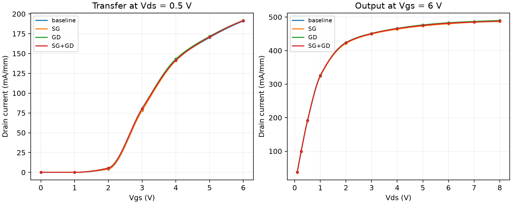
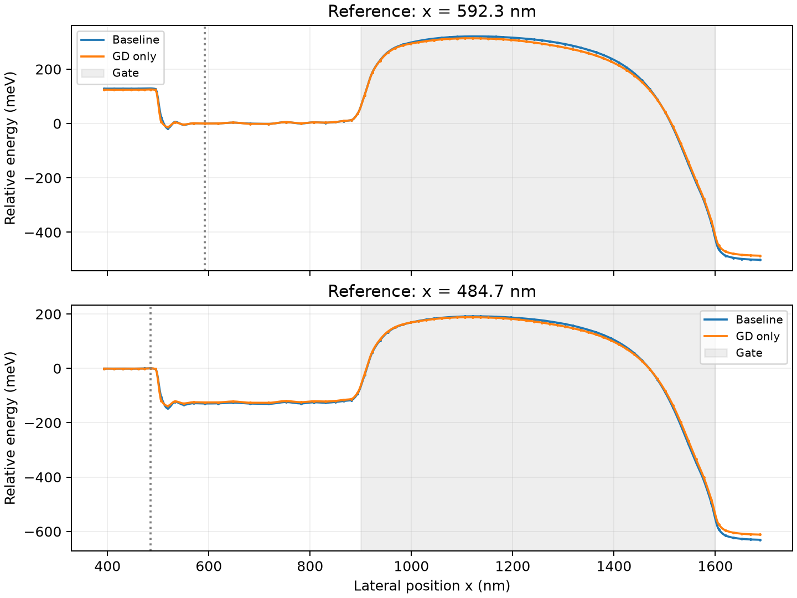

```{=html}
<nav aria-label="SG·GD Interface Charge 목차"><p><a href="#key-results">핵심 결과</a> · <a href="#method">비교 방법</a> · <a href="#iv">전류 특성</a> · <a href="#local">문턱 부근의 국소 변화</a> · <a href="#band">전도대 변화</a> · <a href="#literature">실험 문헌과 해석 범위</a> · <a href="#data">데이터</a></p></nav>

<section id="key-results" style="scroll-margin-top:90px"><h2>핵심 결과</h2><p>SG와 GD의 SiN/AlGaN 계면에 균일한 고정 음전하를 추가하고 정상상태 특성의 변화를 비교했습니다. <a href="gate-algan-charge.html">Gate AlGaN Charge</a>에서 Gate 아래에 넣었던 것과 같은 면밀도 10¹² cm⁻²를 이번에는 접근 영역 표면에 배치한 후속 비교입니다.</p><ul><li><strong>강한 ON 상태:</strong> 같은 Vgs에서 8 V 전류 변화는 0.31% 이내, 겉보기 ON 저항 변화는 약 1.1% 이내로 작습니다.</li><li><strong>문턱:</strong> GD에 전하를 넣은 두 조건(GD, SG+GD)에서만 5 mA/mm 기준 문턱전압이 약 27–28 mV 낮아집니다. SG 단독은 −0.5 mV로 변화가 없습니다.</li><li><strong>채널 밀도:</strong> 대전한 영역 아래의 전자 면밀도가 약 7% 줄지만, Gate 아래 평균 밀도는 거의 변하지 않습니다.</li><li><strong>해석 범위:</strong> GD 조건에서 문턱 부근 전류가 늘었다는 관측은 유지하지만, 그 원인을 Source 주입 장벽 저하로 확정하지는 않습니다.</li></ul></section>

<section id="method" style="scroll-margin-top:90px"><h2>비교 방법</h2><p>SG는 Source–Gate 사이 400 nm, GD는 Gate–Drain 사이 1,225 nm입니다. 대전한 영역마다 전자 수로 환산한 면밀도 10¹² cm⁻²의 음전하를 AlGaN 쪽 첫 1.5 nm 셀에 넣었습니다. 따라서 GD 단독의 총 추가 전하는 SG 단독의 3.06배입니다. Gate 아래에는 기존 분극을 유지했습니다. 고정전하는 Poisson 방정식에 반영했고 이동 입자 총량은 고정했습니다.</p><p>네 조건(추가 전하 없음, SG, GD, SG+GD)은 같은 저장 상태에서 시작했습니다. 자가발열과 정공 hard wall을 적용하고, 조건별 30개 전압에서 안정화·정밀도 기준을 충족한 뒤 평균 전류를 비교했습니다. 대조군은 이번에 새로 계산한 추가 전하가 없는 조건입니다.</p></section>

<section id="iv" style="scroll-margin-top:90px"><h2>전류 특성</h2><div style="overflow-x:auto"><table class="table"><thead><tr><th>추가 음전하</th><th>문턱전압 (V)</th><th>기준 대비 이동 (mV)</th><th>겉보기 ON 저항 (Ω·mm)</th><th>8 V 전류 (mA/mm)</th></tr></thead><tbody><tr><td>없음</td><td>2.0153</td><td>—</td><td>2.625</td><td>488.46</td></tr><tr><td>SG</td><td>2.0148</td><td>−0.5</td><td>2.597</td><td>486.98</td></tr><tr><td>GD</td><td>1.9870</td><td>−28.3</td><td>2.621</td><td>489.77</td></tr><tr><td>SG+GD</td><td>1.9886</td><td>−26.7</td><td>2.597</td><td>488.01</td></tr></tbody></table></div><p>문턱은 Vds = 0.5 V에서 5 mA/mm 교차점을 선형 보간했습니다. ON 저항은 Vgs = 6 V에서 Vds = 0.10, 0.25, 0.50 V의 전류 기울기로 구했습니다. 같은 Vgs에서 8 V 전류 변화는 0.31% 이내, 겉보기 ON 저항 변화는 약 1.1% 이내였습니다. 8 V 전류 평균의 개별 블록 표준오차는 0.25–0.28 mA/mm입니다. 이 값은 조건 간 차이의 전체 불확실성을 나타내지 않습니다.</p><figure class="figure" style="display:block;margin:1.5rem 0"><a href="images/sg-gd/iv.png"></a><figcaption class="figure-caption">Figure 1. 전달특성(왼쪽)과 출력특성(오른쪽). 점은 계산값이며 곡선은 시각화를 위한 PCHIP 보간입니다. 왼쪽은 1 V 간격의 하향 스윕이며, 표의 문턱은 세부 전압 조건에서 추출했습니다.</figcaption></figure></section>

<section id="local" style="scroll-margin-top:90px"><h2>문턱 부근의 국소 변화</h2><p>Vgs = 2.00 V, Vds = 0.5 V에서 <strong>동일한 1 V 간격 하향 스윕</strong>을 비교하면 전류는 기준 4.11, SG 4.28, GD 5.51, SG+GD 5.34 mA/mm였습니다. 각 평균의 블록 표준오차는 0.16–0.21 mA/mm였습니다. GD를 대전한 두 조건에서만 평균 전류가 5 mA/mm를 넘었습니다.</p><p>각 조건의 최종 문턱 추출에 쓰인 2.00 V 자료로 채널 밀도도 확인했습니다. 각 영역에서 GaN 채널 상단 10 nm(z = 116–126 nm)의 전자 밀도를 깊이 적분하고, 가로 길이와 최종 평균 구간에 걸쳐 평균했습니다. 아래 값의 단위는 10¹² cm⁻²입니다. 이 표는 기준·SG에서 0.05 V 세부 스윕, GD·SG+GD에서 1 V 스윕 자료를 사용하므로 동일 바이어스에서도 직전 전압 이력이 다릅니다.</p><div style="overflow-x:auto"><table class="table"><thead><tr><th>추가 음전하</th><th>SG 아래</th><th>Gate 아래</th><th>GD 아래</th></tr></thead><tbody><tr><td>없음</td><td>10.592</td><td>0.2493</td><td>10.915</td></tr><tr><td>SG</td><td>9.876</td><td>0.2402</td><td>10.920</td></tr><tr><td>GD</td><td>10.615</td><td>0.2489</td><td>10.147</td></tr><tr><td>SG+GD</td><td>9.899</td><td>0.2382</td><td>10.152</td></tr></tbody></table></div><p>SG 단독에서는 SG 아래 면밀도가 약 6.8%, GD 단독에서는 GD 아래 면밀도가 약 7.0% 줄었습니다. GD 단독에서 문턱 부근 전류가 늘었지만 Gate 아래의 평균 면밀도는 기준과 거의 같았습니다. Gate 전체의 평균 밀도만으로 문턱 이동의 원인을 설명하기는 어렵습니다.</p></section>

<section id="band" style="scroll-margin-top:90px"><h2>Source에서 Gate로 접근할 때의 전도대 변화</h2><p>동일한 1 V 간격 하향 스윕에서 Vgs = 2.00 V, Vds = 0.5 V의 최종 전류 평균 구간에 저장한 전위를 사용했습니다. 각 2,000 step 블록의 후반 1,000 step 전위를 평균하고, GaN 상단 116–126 nm에서 격자 두께로 가중 평균했습니다. 균일한 GaN 안에서 전도대의 정전기 성분은 −qφ이므로 두 위치의 전위차로 상대 에너지를 구했습니다. 아래 최고점은 Gate 구간(900–1,600 nm)의 <strong>계산 격자</strong>에서 읽었습니다.</p><figure class="figure" style="display:block;margin:1.5rem 0"><a href="images/sg-gd/barrier.png"></a><figcaption class="figure-caption">Figure 2. 두 기준 위치에서 비교한 Source–Gate 채널의 상대 전도대 에너지(기준 조건과 GD 단독). 점선은 에너지 기준 위치, 음영은 Gate 구간입니다.</figcaption></figure><div style="overflow-x:auto"><table class="table"><thead><tr><th>에너지 기준 위치</th><th>기준 조건의 Gate 최고점 (meV)</th><th>GD 단독 (meV)</th><th>GD − 기준 (meV)</th></tr></thead><tbody><tr><td>SG 내부 x = 592.3 nm</td><td>320.67</td><td>313.57</td><td>−7.10</td></tr><tr><td>Source 전극 아래 GaN x = 484.7 nm</td><td>191.43</td><td>188.18</td><td>−3.25</td></tr></tbody></table></div><p>두 기준에서 모두 GD 대전 후 상대 높이가 낮아졌습니다. Source 아래에서는 121 nm까지 내려온 금속 셀을 제외하여 121.7–124.9 nm의 GaN 셀 중심 세 곳만 반영했으므로, 두 기준에서 깊이 평균의 유효 범위가 다릅니다. 수 meV의 감소는 전류 증가 방향과 정성적으로 일치합니다. 최고점 위치는 기준 x = 1,120.7 nm, GD 단독 x = 1,105.4 nm로 한 격자만큼 달랐습니다.</p><p>두 기준점 모두 채널의 국소 전도대 에너지이며 Source의 전자 준페르미 준위를 측정한 값은 아닙니다. 따라서 <strong>GD 조건에서 문턱 부근 전류가 증가했다는 관측은 유지하되, 그 원인을 Source 주입 장벽 저하로 확정하기는 어렵습니다.</strong> 이 비교는 한 계산 이력의 시간 평균입니다.</p></section>

<section id="literature" style="scroll-margin-top:90px"><h2>실험 문헌과 해석 범위</h2><p id="ref1">[1] <strong>Danesin 등</strong>은 SiC 기판 HEMT의 고온 보관 실험에서 DC 문턱 이동을 관측하지 않았지만, 펄스 측정에서는 뚜렷한 전류 붕괴를 보고했고 이를 SG·GD 접근 영역 표면 트랩과 연결했습니다. 장시간 열화에서 DC 포화전류도 20% 감소해, DC 변화의 크기 자체는 이번 계산과 다릅니다. <a href="https://www.sciencedirect.com/science/article/abs/pii/S002627140800231X"><em>Microelectronics Reliability</em> (2008)</a></p><p id="ref2">[2] <strong>Wu 등</strong>의 p-GaN HEMT에서는 650 V, 10 ms 스트레스 후 동적/정적 ON 저항비가 기존 소자에서 4.30, GD 측 능동 패시베이션 소자에서 1.39였습니다. 이는 고전압 스트레스 후 측정 결과입니다. 이번 계산은 고정된 전하 분포 아래 최대 8 V의 준정적 응답을 다루므로 이 동적 저항비와 직접 비교할 수 없습니다. <a href="https://ieeexplore.ieee.org/document/9950512/"><em>IEEE Electron Device Letters</em></a></p><p id="ref3">[3] <strong>Catoggio 등</strong>의 RF HEMT 모델은 장벽/패시베이션 계면에 −2 × 10¹² cm⁻²의 고정전하를 적용했습니다. 전하 부호와 크기를 선정하는 참고 사례이며, 이번 SG·GD별 전류 변화율의 실험 검증은 아닙니다. <a href="https://www.mdpi.com/2079-9292/12/11/2457"><em>Electronics</em> (2023)</a></p></section>

<section id="data" style="scroll-margin-top:90px"><h2>데이터</h2><p><a href="data/sg-gd/iv.csv">전압 조건별 전류와 블록 표준오차</a> · <a href="data/sg-gd/channel-profile.csv">채널 상대 에너지 분포 (meV, x = 592.3 nm 기준)</a></p></section>

```
