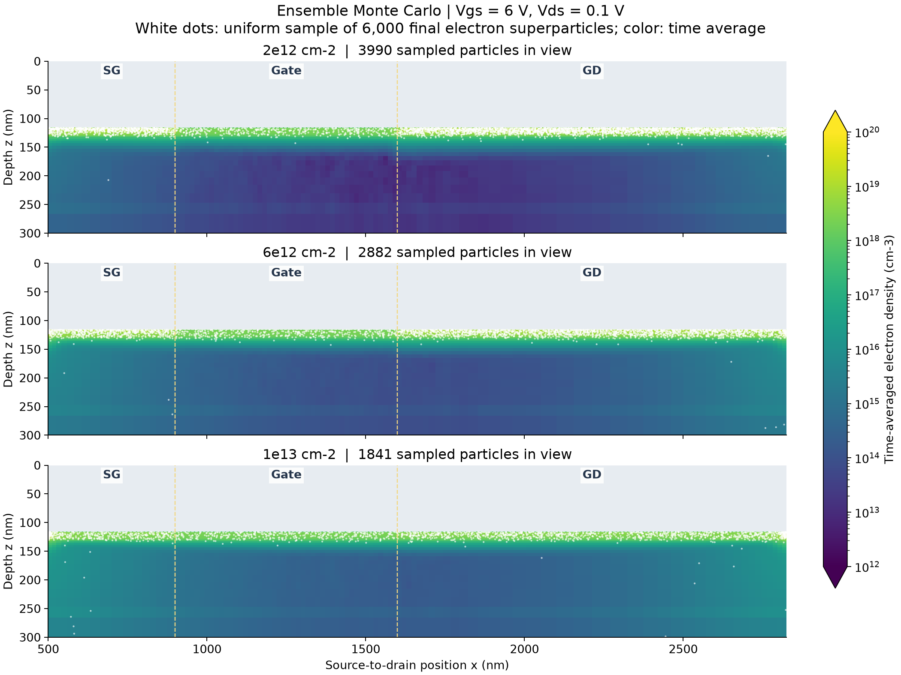
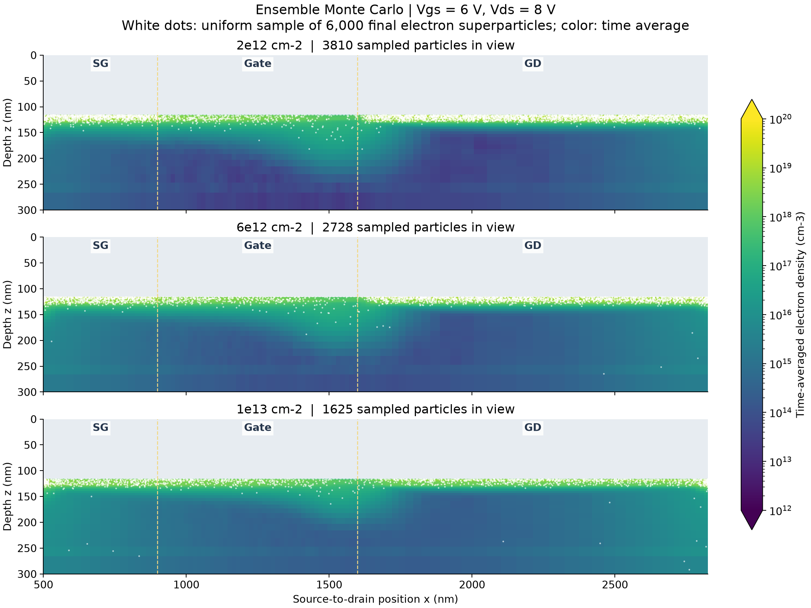
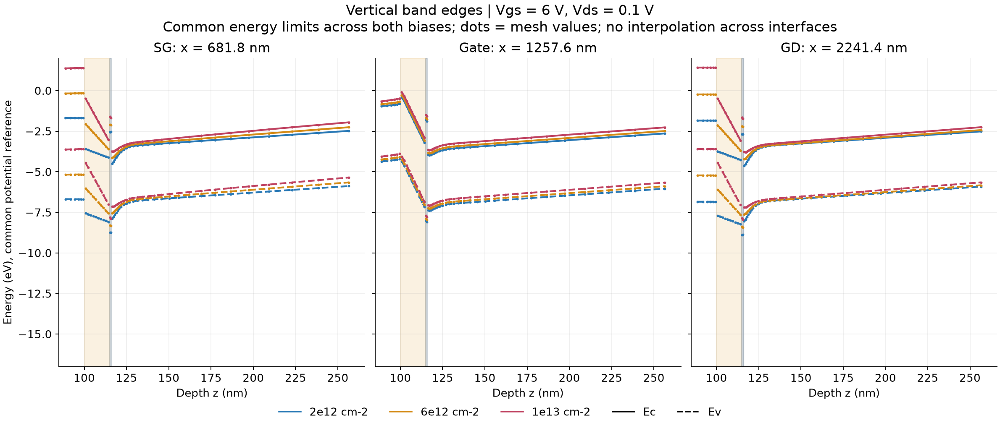
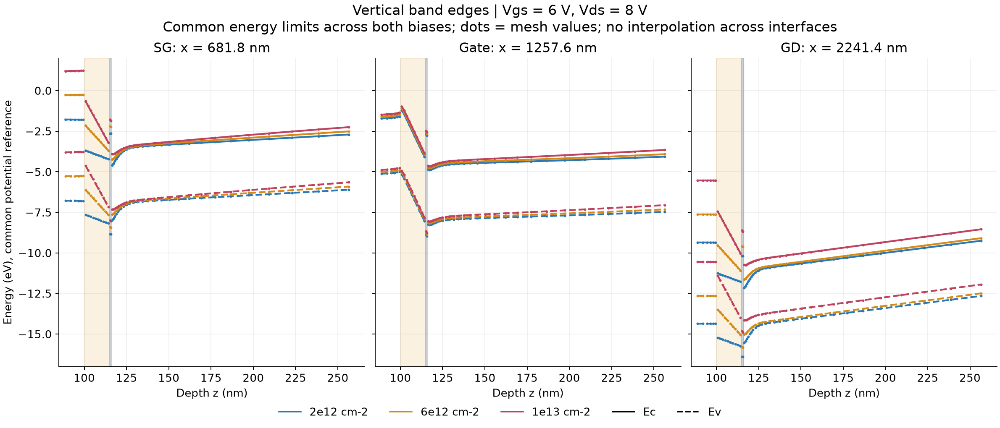
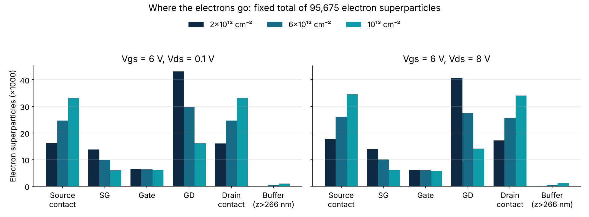
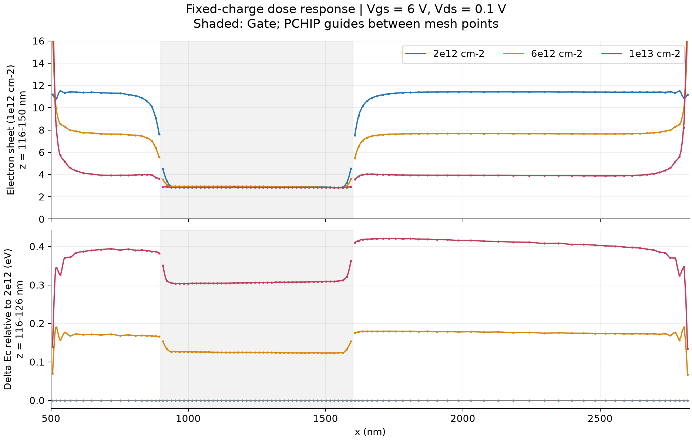
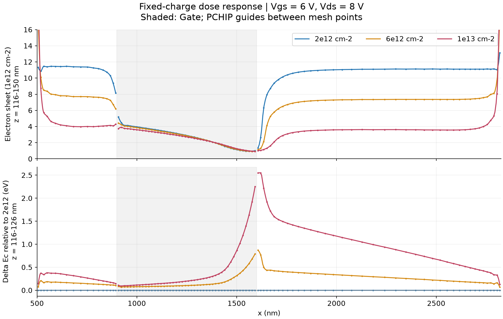

```{=html}
<nav aria-label="SG·GD Charge Dose 목차"><p><a href="#key-results">핵심 결과</a> · <a href="#setup">조건과 전하량의 의미</a> · <a href="#band-basics">에너지 밴드 읽기</a> · <a href="#cloud">Monte Carlo 전자 구름</a> · <a href="#sheet">접근 영역 전자 밀도</a> · <a href="#accounting">빠진 전자의 행방</a> · <a href="#ec">전도대 변화의 분해</a> · <a href="#current">전류</a> · <a href="#scope">해석 범위와 다음 계산</a> · <a href="#references">참고 문헌과 데이터</a></p></nav>

<section id="key-results" style="scroll-margin-top:90px"><h2>핵심 결과</h2><p><a href="sg-gd-charge.html">SG·GD Interface Charge</a>에서 10¹² cm⁻²로 보았던 SG·GD의 SiN/AlGaN 계면 고정 음전하를 2×10¹², 6×10¹², 10¹³ cm⁻²로 키우고, 에너지 밴드·시간 평균 전자 밀도·실제 Monte Carlo 입자 분포·전류를 함께 비교했습니다. 게시 전에 소자물리, 수치해석·통계, 문헌의 세 관점에서 검토를 거쳤고, 그 결과 원래 원고의 해석 일부를 바로잡았습니다.</p><ul><li><strong>접근 영역 고갈:</strong> 전하를 2×10¹²에서 10¹³ cm⁻²로 늘리면(추가 8×10¹² cm⁻²) SG·GD 채널의 전자 면밀도가 약 6–7×10¹² cm⁻² 줄어듭니다. 추가 전하의 78–88%를 2DEG가 받아내는 것으로, 정전기적으로 타당한 크기입니다.</li><li><strong>8 V 전류:</strong> 488.19 → 467.46 → 421.87 mA/mm로, 2×10¹² 대비 4.25%, 13.58% 감소합니다. 같은 온도라면 감소폭은 이보다 클 것으로 예상됩니다.</li><li><strong>모델 조건의 영향:</strong> 이동전자 총량을 고정했기 때문에 SG·GD에서 빠진 전자의 약 98%가 Source·Drain 접촉 아래로 옮겨 갔고, 접촉 아래 면밀도가 약 2배가 되었습니다. 실제 옴 접촉에서는 일어나지 않는 현상입니다.</li><li><strong>바로잡은 해석:</strong> 0.1 V에서 세 영역의 전도대가 약 0.3 eV 함께 오른 것은 소자 전체의 기준 전위 이동이며, 전하가 놓인 SG·GD 고유의 상승은 약 0.07–0.10 eV입니다. 0.1 V의 비단조 전류는 반복 계산에서 재현되지만, 모델 조건에 의존할 가능성이 커서 물리 현상으로 해석하지 않습니다.</li></ul><p>따라서 이 페이지의 정량값은 “전자 총량을 고정한 모델에서의 전하량 민감도”입니다. 전하 중성 접촉으로 다시 계산하기 전까지 실제 소자의 크기로 일반화하지 않습니다.</p></section>

<section id="setup" style="scroll-margin-top:90px"><h2>계산 조건과 전하량의 의미</h2><div style="overflow-x:auto"><table class="table"><thead><tr><th>항목</th><th>조건</th></tr></thead><tbody><tr><td>바이어스</td><td>Vgs = 6 V; Vds = 0.1, 0.25, 0.5, 8 V</td></tr><tr><td>입자와 시간 간격</td><td>전자·정공 superparticle 100,000개(전자 95,675개), 1 fs; 이동입자 총수와 가중치 고정</td></tr><tr><td>영역</td><td>SG x = 500–900 nm, Gate 900–1,600 nm, GD 1,600–2,825 nm</td></tr><tr><td>층 구조</td><td>AlGaN(Al 0.20) z = 100–115 nm, AlN 115–116 nm, GaN 채널 116–266 nm; Gate 아래 z &lt; 100 nm는 p-GaN, SG·GD는 SiN</td></tr><tr><td>추가 전하</td><td>SG·GD의 z = 100 nm 계면을 나타내도록 AlGaN 쪽 첫 1.5 nm 셀에 균일 배분; 두 영역에 같은 면밀도</td></tr><tr><td>열 모델</td><td>기판 300 K, 열저항 20 K·mm/W의 일괄(lumped) 자가발열; 소자 온도 = 300 K + R<sub>th</sub>·P</td></tr><tr><td>평균</td><td>같은 바이어스에서 세 전하 조건 모두 같은 평균 길이(0.1–0.5 V 480,000 steps, 8 V 160,000 steps); 난수 시드는 한 가지(801)</td></tr></tbody></table></div><p>같은 면밀도라도 GD(1,225 nm)가 SG(400 nm)보다 길어 총전하량은 같지 않습니다. 기준 조건인 2×10¹² cm⁻²도 추가 전하가 없는 상태가 아닙니다.</p><p><strong>전하량의 크기.</strong> 2×10¹² cm⁻²는 TCAD 문헌에서 패시베이션 계면 포획을 대표하는 고정 음전하(−2×10¹² cm⁻²) <a href="#ref6">[6]</a>와 같은 수준입니다. Al<sub>0.2</sub>Ga<sub>0.8</sub>N/GaN의 분극 전하는 약 1.1×10¹³ cm⁻² <a href="#ref2">[2]</a><a href="#ref3">[3]</a>이고, 2DEG의 전자는 이를 보상하는 표면 상태에서 온다고 봅니다 <a href="#ref1">[1]</a>. 6×10¹²·10¹³ cm⁻²는 이 분극 전하에 근접하는 <strong>강한 고갈의 민감도 조건</strong>이며 일반적인 공정값이 아닙니다. 실측된 SiN/AlGaN 순 고정전하는 공정에 따라 오히려 양(+1.3–7.1×10¹² cm⁻²)으로도 보고됩니다 <a href="#ref5">[5]</a>.</p></section>

<section id="band-basics" style="scroll-margin-top:90px"><h2>에너지 밴드는 전자가 보는 에너지 지형입니다</h2><p>전자의 전하는 −q이므로 전위 φ가 만드는 정전기적 위치 에너지는 −qφ입니다. 같은 재료 안에서 전위가 낮아지면 전도대 하단 E<sub>c</sub>는 올라가며, ΔE<sub>c</sub> = −qΔφ입니다(eV와 V로 표시하면 ΔE<sub>c</sub>[eV] = −Δφ[V]). 재료 상수가 같은 영역에서는 E<sub>c</sub>와 E<sub>v</sub>가 같은 양만큼 함께 움직입니다. 밴드의 기울기는 전기장을 나타내며(∇E<sub>c</sub> = qE), 전자가 받는 힘은 −∇E<sub>c</sub>입니다 <a href="#ref9">[9]</a>.</p><p>그림의 밴드는 코드의 재료 상수와 계산된 전위로 E<sub>c</sub>[eV] = −χ − φ[V], E<sub>v</sub> = E<sub>c</sub> − E<sub>g</sub>로 구성했습니다. GaN·AlGaN·AlN의 χ와 E<sub>g</sub>가 달라 재료 경계에는 단차가 생기고, 같은 재료 안의 부드러운 휨은 공간적으로 달라지는 전위를 반영합니다. 양자 준위와 준페르미 준위는 포함하지 않았으므로, <strong>E<sub>c</sub>의 절대 높이를 영역 사이에 비교하지 않고</strong> 같은 위치에서 전하 조건 사이의 변화만 비교합니다.</p></section>

<section id="cloud" style="scroll-margin-top:90px"><h2>Monte Carlo 전자 구름</h2><p>Ensemble Monte Carlo는 개별 입자의 자유비행과 확률적 산란을 계산하고, 입자 분포로 전하 밀도를 구성해 Poisson 방정식으로 전위를 갱신하는 과정을 반복합니다 <a href="#ref7">[7]</a>. 그림의 <strong>바탕색은 시간 평균 전자 밀도</strong>, <strong>흰 점은 마지막 체크포인트의 전자 superparticle에서 비복원 균일 추출한 6,000개 표본</strong>입니다. 한 점은 여러 전자를 대표하는 계산 입자이며, 점 크기는 표시용입니다.</p><figure class="figure" style="display:block;margin:1.5rem 0"><a href="images/sg-gd-dose/electron-cloud-0p1V.png"></a><figcaption class="figure-caption">Figure 1. Vgs = 6 V, Vds = 0.1 V. 화면 안의 표본 수는 3,990 → 2,882 → 1,841개로 줄어듭니다.</figcaption></figure><figure class="figure" style="display:block;margin:1.5rem 0"><a href="images/sg-gd-dose/electron-cloud-8V.png"></a><figcaption class="figure-caption">Figure 2. Vgs = 6 V, Vds = 8 V. 화면 안의 표본 수는 3,810 → 2,728 → 1,625개입니다.</figcaption></figure><p>전하량이 늘면 SG·GD의 전자 구름이 옅어집니다. 화면 안의 점이 줄어드는 것은 전체 입자 수가 줄어서가 아닙니다. 줄어든 점의 대부분은 화면 밖의 Source·Drain 접촉 아래로 옮겨 갔습니다(<a href="#accounting">빠진 전자의 행방</a> 참고). 표본 수의 비율은 시간 평균 밀도의 비율과 맞지만, 정량 판단은 아래의 시간 평균 값으로 합니다.</p></section>

<section id="sheet" style="scroll-margin-top:90px"><h2>접근 영역의 전자 면밀도</h2><figure class="figure" style="display:block;margin:1.5rem 0"><a href="images/sg-gd-dose/bands-0p1V.png"></a><figcaption class="figure-caption">Figure 3. Vds = 0.1 V에서 SG·Gate·GD 중앙에 가장 가까운 격자(x = 681.8, 1,257.6, 2,241.4 nm)의 성장 방향 밴드. 실선 E<sub>c</sub>, 점선 E<sub>v</sub>, 주황 AlGaN, 회색 AlN. 재료 경계를 가로질러 보간하지 않았습니다.</figcaption></figure><figure class="figure" style="display:block;margin:1.5rem 0"><a href="images/sg-gd-dose/bands-8V.png"></a><figcaption class="figure-caption">Figure 4. Vds = 8 V. GD의 GaN 전도대가 SG보다 낮게 놓인 것은 GD의 채널 전위가 높기 때문이며, 밴드갭이 작아졌다는 뜻이 아닙니다.</figcaption></figure><p>아래 표는 GaN 채널 z = 116–150 nm의 전자 밀도를 깊이 적분하고 각 영역 길이로 평균한 면밀도입니다(단위 10¹² cm⁻²).</p><div style="overflow-x:auto"><table class="table"><thead><tr><th>Vds</th><th>고정 음전하 (cm⁻²)</th><th>SG</th><th>Gate</th><th>GD</th></tr></thead><tbody><tr><td>0.1 V</td><td>2×10¹²</td><td>11.012</td><td>3.001</td><td>11.279</td></tr><tr><td>0.1 V</td><td>6×10¹²</td><td>7.935</td><td>2.922</td><td>7.759</td></tr><tr><td>0.1 V</td><td>10¹³</td><td>4.796</td><td>2.845</td><td>4.216</td></tr><tr><td>8 V</td><td>2×10¹²</td><td>11.105</td><td>2.730</td><td>10.653</td></tr><tr><td>8 V</td><td>6×10¹²</td><td>8.041</td><td>2.673</td><td>7.131</td></tr><tr><td>8 V</td><td>10¹³</td><td>4.911</td><td>2.559</td><td>3.666</td></tr></tbody></table></div><p>0.1 V에서 2×10¹² → 10¹³ cm⁻²로 추가 전하가 8×10¹² cm⁻² 늘 때 SG는 6.2, GD는 7.1×10¹² cm⁻² 줄었습니다. 추가 전하의 78%(SG), 88%(GD)를 바로 아래 2DEG가 받아낸 셈입니다. 1차원 축전기 모델이라면 100%에 가까워야 하며, 나머지는 측면 fringing과 접촉 쪽이 받아냈습니다. 짧은 SG의 비율이 더 낮은 것도 이와 일관됩니다. AlGaN 내부 전위 기울기에 Gauss 법칙을 적용해도 하부 유도 전하가 7.7×10¹² cm⁻²로 추가 전하와 맞습니다.</p><p>Gate 아래의 감소(8 V에서 6.3%)는 영역 끝 셀이 섞인 값이며, Gate 내부만 보면 0.1 V에서 약 3%입니다.</p></section>

<section id="accounting" style="scroll-margin-top:90px"><h2>SG·GD에서 빠진 전자는 어디로 갔는가</h2><p>이 계산은 이동전자 총량을 고정합니다. 전체 전자량은 세 조건 모두 3.0977×10¹¹ m⁻¹로 같으므로, SG·GD에서 줄어든 전자는 소자 밖으로 나가지 않고 다른 곳에 쌓여야 합니다.</p><figure class="figure" style="display:block;margin:1.5rem 0"><a href="images/sg-gd-dose/electron-accounting.png"></a><figcaption class="figure-caption">Figure 5. 영역별 전자 superparticle 수(시간 평균 밀도를 적분해 환산, 합계 95,675). Source·Drain 접촉은 x &lt; 500, x &gt; 2,825 nm의 z ≤ 266 nm 영역입니다.</figcaption></figure><div style="overflow-x:auto"><table class="table"><thead><tr><th>Vds</th><th>고정 음전하 (cm⁻²)</th><th>Source 접촉</th><th>SG</th><th>Gate</th><th>GD</th><th>Drain 접촉</th><th>Buffer</th></tr></thead><tbody><tr><td>0.1 V</td><td>2×10¹²</td><td>16,124</td><td>13,745</td><td>6,532</td><td>43,073</td><td>16,113</td><td>88</td></tr><tr><td>0.1 V</td><td>6×10¹²</td><td>24,617</td><td>9,952</td><td>6,365</td><td>29,701</td><td>24,620</td><td>420</td></tr><tr><td>0.1 V</td><td>10¹³</td><td>33,125</td><td>6,041</td><td>6,206</td><td>16,153</td><td>33,137</td><td>1,013</td></tr><tr><td>8 V</td><td>2×10¹²</td><td>17,615</td><td>13,875</td><td>6,080</td><td>40,753</td><td>17,176</td><td>175</td></tr><tr><td>8 V</td><td>6×10¹²</td><td>26,116</td><td>10,099</td><td>5,939</td><td>27,355</td><td>25,649</td><td>517</td></tr><tr><td>8 V</td><td>10¹³</td><td>34,549</td><td>6,190</td><td>5,645</td><td>14,133</td><td>34,057</td><td>1,102</td></tr></tbody></table></div><p>0.1 V에서 2×10¹² → 10¹³ cm⁻²로 SG·GD에서 약 34,600개가 줄었고, 그중 약 34,000개(98%)가 Source·Drain 접촉 아래로, 약 900개가 buffer로 옮겨 갔습니다. Source 접촉 아래 면밀도는 10.4 → 15.9 → 21.4×10¹² cm⁻²로 두 배가 됩니다. 실제 옴 접촉이라면 이 전자는 외부 회로로 빠져나가야 하지만, 이 모델에서는 접촉이 전자를 저장하는 축전기처럼 동작합니다. <strong>아래의 전위 이동과 저전압 전류에는 이 영향이 포함되어 있습니다.</strong></p></section>

<section id="ec" style="scroll-margin-top:90px"><h2>전도대 변화: 기준 전위 이동과 국소 고갈의 분리</h2><figure class="figure" style="display:block;margin:1.5rem 0"><a href="images/sg-gd-dose/channel-response-0p1V.png"></a><figcaption class="figure-caption">Figure 6. Vds = 0.1 V. 위: 전자 면밀도(z = 116–150 nm), 아래: 2×10¹² cm⁻² 대비 E<sub>c</sub> 변화(z = 116–126 nm). 회색은 Gate. 곡선은 격자값 사이의 PCHIP 표시입니다. 위 그림의 y축 상한 때문에 접촉 쪽의 21–22×10¹² cm⁻² 상승은 잘려 있습니다.</figcaption></figure><p>0.1 V에서 z = 116–126 nm 평균 E<sub>c</sub>는 2×10¹² → 10¹³ cm⁻²로 SG 약 0.38, Gate 0.31, GD 0.40 eV 올랐습니다. 세 값이 거의 같고, 깊은 buffer(z = 1.5 µm)의 전위도 접촉 아래를 포함해 x 전 구간에서 약 0.2–0.3 V 고르게 내려갑니다. 즉 약 0.3 eV는 <strong>소자 전체의 기준 전위 이동</strong>이며, 접촉 아래에 쌓인 전자와 관련이 있습니다. Gate 아래에서 E<sub>c</sub>가 0.31 eV 올라도 밀도가 약 3%만 줄어드는 것도 이 때문입니다.</p><p>Gate를 기준으로 빼면 전하가 놓인 SG·GD 고유의 상승은 약 0.07–0.10 eV입니다. 축퇴 통계로 계산한 국소 (E<sub>F</sub> − E<sub>c</sub>) 변화 약 0.085 eV(채널 상부 밀도 1.4×10¹⁹ → 3.4×10¹⁸ cm⁻³)와 맞으며, 이 값이 국소 전자 밀도 감소와 정량적으로 대응합니다.</p><figure class="figure" style="display:block;margin:1.5rem 0"><a href="images/sg-gd-dose/channel-response-8V.png"></a><figcaption class="figure-caption">Figure 7. Vds = 8 V. GD의 E<sub>c</sub> 변화가 Gate 드레인 끝에서 가장 크고 Drain 쪽으로 갈수록 줄어듭니다.</figcaption></figure><p>8 V, 2×10¹² → 10¹³ cm⁻²에서 영역 평균 E<sub>c</sub> 상승은 SG 0.283, Gate 0.414, GD 1.003 eV이며, 국소 최대값은 Gate 드레인 끝 약 2.25 eV, GD 시작점 약 2.55 eV입니다. GD의 큰 상승은 고정 음전하가 Gate 드레인 끝의 공핍 영역을 Drain 쪽으로 넓혀 Drain 전압이 강하되는 위치가 바뀐 결과입니다. x = 1,635 nm의 밀도는 6.3 → 1.2×10¹² cm⁻²로 줄었습니다. 이는 표면 음전하가 접근 영역의 2DEG를 고갈시키는 가상 게이트(virtual gate) <a href="#ref4">[4]</a>가 넓어지는 것과 같은 방향의 변화입니다. 다만 Vetury 등은 동적 포획을 다루었고, 이 계산은 정적인 고정전하입니다.</p><p>전하를 1.5 nm 두께에 나눠 놓았기 때문에, 이상적인 면전하와 비교해 약 0.12 V(추가 8×10¹² cm⁻² 기준)의 쌍극자 차이가 있습니다.</p></section>

<section id="current" style="scroll-margin-top:90px"><h2>전류</h2><p>국소 전류밀도는 전하량·전자 밀도·평균 속도의 곱이므로, 같은 밀도에서도 속도가 다르면 전류가 달라집니다. 보고 전류는 x = 600–2,725 nm 수송 구간 전자의 속도 합을 시간 평균한 값입니다. 괄호는 블록 SEM으로, 시간 표본의 통계 진단값이며 모델·격자·초기조건을 포함한 전체 불확실성은 아닙니다.</p><div style="overflow-x:auto"><table class="table"><thead><tr><th>Vds</th><th>2×10¹² cm⁻²</th><th>6×10¹² cm⁻²</th><th>10¹³ cm⁻²</th></tr></thead><tbody><tr><td>0.1 V</td><td>37.00 (0.25)</td><td>39.01 (0.24)</td><td>30.69 (0.15)</td></tr><tr><td>0.25 V</td><td>98.34 (0.19)</td><td>93.70 (0.19)</td><td>71.18 (0.20)</td></tr><tr><td>0.5 V</td><td>190.78 (0.20)</td><td>176.35 (0.19)</td><td>133.65 (0.16)</td></tr><tr><td>8 V</td><td>488.19 (0.23)</td><td>467.46 (0.29)</td><td>421.87 (0.20)</td></tr></tbody></table></div><p>단위는 mA/mm, Vgs = 6 V입니다. 0.25, 0.5, 8 V에서는 전하량이 늘수록 전류가 줄어듭니다. 8 V 전류는 2×10¹² 대비 4.25%, 13.58% 감소합니다.</p><h3>0.1 V의 비단조성: 반복 계산으로 확인</h3><p>처음 계산에서는 0.1 V의 6×10¹² 조건(39.01 mA/mm)이 2×10¹² 조건(37.00)보다 높았습니다. 처음 계산은 난수 시드가 하나뿐이었고 버린 구간도 조건마다 달랐으므로, 모델은 그대로 두고 0.1 V를 다시 계산했습니다. 모든 반복에서 램프 뒤 200,000 steps를 버리고 480,000 steps를 고정 평균했으며, 결과를 보고 평균 구간을 옮기지 않았습니다. 시드별 GPU 난수열이 실제로 서로 다르다는 것과 블록 단위 전류 이력이 서로 상관되지 않는다는 것도 확인했습니다.</p><div style="overflow-x:auto"><table class="table"><thead><tr><th>고정 음전하 (cm⁻²)</th><th>계산</th><th>전류 (mA/mm)</th><th>블록 SEM</th><th>전·후반 차이</th><th>안정화·정밀도 진단</th></tr></thead><tbody><tr><td>2×10¹²</td><td>저장 상태 · 801</td><td>36.57</td><td>0.24</td><td>0.01</td><td>통과</td></tr><tr><td>2×10¹²</td><td>저장 상태 · 1801</td><td>36.56</td><td>0.19</td><td>0.16</td><td>통과</td></tr><tr><td>2×10¹²</td><td>저장 상태 · 2801</td><td>36.57</td><td>0.21</td><td>0.12</td><td>통과</td></tr><tr><td>2×10¹²</td><td>0 V부터 독립 초기화 · 3801</td><td>36.39</td><td>0.22</td><td>0.12</td><td>통과</td></tr><tr><td>6×10¹²</td><td>저장 상태 · 1801</td><td>38.85</td><td>0.17</td><td>0.40</td><td>통과</td></tr><tr><td>6×10¹²</td><td>저장 상태 · 2801</td><td>38.81</td><td>0.27</td><td>0.58</td><td>전류 차이·SEM 초과</td></tr><tr><td>10¹³</td><td>저장 상태 · 1801</td><td>30.41</td><td>0.17</td><td>0.09</td><td>전위 RMS 초과</td></tr></tbody></table></div><p>2×10¹² 조건은 시드 3개와 0 V부터의 독립 초기화 모두 36.4–36.6 mA/mm로, 6×10¹² 조건(38.8–38.9)보다 약 2.3 mA/mm 낮았습니다. 6×10¹²의 seed 2801은 미리 정한 기준(전·후반 차이 0.5 mA/mm, SEM 0.25 mA/mm)을 조금 넘었지만, 그 계산의 전반(39.10)·후반(38.52) 평균도 모두 2×10¹²보다 약 2 mA/mm 높습니다. 따라서 <strong>이 비단조성은 단일 계산의 통계적 이상치가 아니며, 차이의 방향은 재현됩니다.</strong> 엄격한 사전 기준으로는 6×10¹² 반복 하나가 진단을 통과하지 못했으므로, 차이의 크기는 약 2.3 ± 0.3 mA/mm 정도로만 봅니다.</p><div style="overflow-x:auto"><table class="table"><thead><tr><th>고정 음전하 (cm⁻²)</th><th>I/V at 0.1 V (mS/mm)</th><th>0.25 V</th><th>0.5 V</th></tr></thead><tbody><tr><td>2×10¹²</td><td>366</td><td>395</td><td>382</td></tr><tr><td>6×10¹²</td><td>388</td><td>375</td><td>353</td></tr><tr><td>10¹³</td><td>304</td><td>285</td><td>267</td></tr></tbody></table></div><p>반복 계산의 평균으로 다시 구한 컨덕턴스입니다(0.5 V와 10¹³의 0.25 V는 처음 계산 값). 2×10¹² 조건만 0.1 V 컨덕턴스가 0.25 V보다 낮은 현상도 반복해서 나타났습니다. 처음 원고에서는 이 점을 2×10¹² 조건의 이상치로 보았으나, 반복 계산으로 그 가설은 맞지 않는 것으로 확인됐습니다.</p><p>가장 유력한 원인은 <a href="#accounting">전자 총량 고정</a>입니다. 0.1 V 선형 영역의 전류는 접촉 아래·접근 영역·Gate 채널 저항의 직렬 합으로 정해지는데, 전하량이 커지면 접근 영역은 고갈되지만 빠진 전자가 접촉 아래에 쌓여 그쪽 저항은 줄어듭니다. 두 효과가 경쟁하면 비단조 응답이 나올 수 있습니다. 이는 아직 검증하지 않은 가설이므로, <strong>0.1 V 비단조성을 실제 소자의 물리 현상으로 해석하지 않습니다.</strong></p><h3>전류 연속성과 자가발열</h3><p>GD 구간에서 따로 구한 전류는 보고 전류보다 전하량 순서로 약 0.07, 0.33, 0.80 mA/mm 낮으며, 바이어스와 무관합니다. 10¹³ cm⁻²에서는 이 차이가 블록 SEM보다 큽니다(0.1 V에서 2.6%).</p><p>8 V의 소자 온도는 열저항 모델(300 K + R<sub>th</sub>·P)로 378.12, 374.80, 367.51 K입니다. 전하량이 클수록 소비전력과 온도가 낮아지므로, 자가발열은 전류 감소를 키운 것이 아니라 일부 상쇄했습니다. 이동도가 T<sup>−1.5</sup>에 비례한다고 보면 약 4%에 해당하므로, 같은 온도에서의 전기적 감소폭은 13.6%보다 클 것으로 예상됩니다. 일괄 온도 모델이라 국소 발열점 효과는 포함하지 않았습니다 <a href="#ref8">[8]</a>.</p></section>

<section id="scope" style="scroll-margin-top:90px"><h2>해석 범위와 다음 계산</h2><div style="overflow-x:auto"><table class="table"><thead><tr><th>결과</th><th>신뢰도</th><th>근거와 한계</th></tr></thead><tbody><tr><td>SG·GD 2DEG 고갈의 크기</td><td>높음</td><td>추가 전하의 78–88%를 2DEG가 받아냄; Gauss 법칙 확인</td></tr><tr><td>8 V에서 GD 공핍 영역의 확장</td><td>정성적으로 타당</td><td>가상 게이트와 같은 방향; 정적 고정전하</td></tr><tr><td>8 V 전류 감소율 4.25%, 13.58%</td><td>방향은 타당, 크기는 모델 의존</td><td>접촉 아래 전자 축적과 자가발열 상쇄 포함</td></tr><tr><td>약 0.3 eV의 공통 E<sub>c</sub> 상승, Gate로의 전달</td><td>모델 조건의 결과</td><td>전자 총량 고정에 따른 기준 전위 이동</td></tr><tr><td>0.1 V 비단조 전류</td><td>방향은 재현됨, 원인 미확인</td><td>시드 3개와 독립 초기화로 재현; 전자 총량 고정의 영향 가능성</td></tr></tbody></table></div><p>이 계산은 지정한 고정 음전하량에 대한 준정적 Monte Carlo 응답이며, 포획·방출 시간상수나 실제 공정의 전하 생성량은 다루지 않습니다. 전위·밀도 그림은 최종 전류 평균 구간의 저장 블록(각 2,000-step 블록의 후반 1,000 step)을 평균했고, 전자 구름은 최종 체크포인트의 한 시점입니다.</p><p>다음 계산에서는 <strong>접촉에서 전자가 들어오고 나갈 수 있는 전하 중성 경계</strong>로 같은 비교를 다시 할 계획입니다. 0.1 V의 반복 계산은 마쳤으며 결과를 위에 반영했습니다. 그때 이 페이지의 전류 감소율과 E<sub>c</sub> 이동을 갱신합니다.</p></section>

<section id="references" style="scroll-margin-top:90px"><h2>참고 문헌과 데이터</h2><p id="ref1">[1] J. P. Ibbetson, P. T. Fini, K. D. Ness, S. P. DenBaars, J. S. Speck, U. K. Mishra, “Polarization effects, surface states, and the source of electrons in AlGaN/GaN heterostructure field effect transistors,” <em>Appl. Phys. Lett.</em> 77, 250 (2000). <a href="https://doi.org/10.1063/1.126940">DOI: 10.1063/1.126940</a></p><p id="ref2">[2] O. Ambacher et al., “Two-dimensional electron gases induced by spontaneous and piezoelectric polarization charges in N- and Ga-face AlGaN/GaN heterostructures,” <em>J. Appl. Phys.</em> 85, 3222 (1999). <a href="https://doi.org/10.1063/1.369664">DOI: 10.1063/1.369664</a></p><p id="ref3">[3] O. Ambacher et al., “Two dimensional electron gases induced by spontaneous and piezoelectric polarization in undoped and doped AlGaN/GaN heterostructures,” <em>J. Appl. Phys.</em> 87, 334 (2000). <a href="https://doi.org/10.1063/1.371866">DOI: 10.1063/1.371866</a></p><p id="ref4">[4] R. Vetury, N. Q. Zhang, S. Keller, U. K. Mishra, “The impact of surface states on the DC and RF characteristics of AlGaN/GaN HFETs,” <em>IEEE Trans. Electron Devices</em> 48, 560 (2001). <a href="https://doi.org/10.1109/16.906451">DOI: 10.1109/16.906451</a></p><p id="ref5">[5] M. Fagerlind et al., “Investigation of the interface between silicon nitride passivations and AlGaN/AlN/GaN heterostructures by C(V) characterization of metal-insulator-semiconductor-heterostructure capacitors,” <em>J. Appl. Phys.</em> 108, 014508 (2010). <a href="https://doi.org/10.1063/1.3428442">DOI: 10.1063/1.3428442</a></p><p id="ref6">[6] E. Catoggio, S. Donati Guerrieri, F. Bonani, “TCAD Modeling of GaN HEMT Output Admittance Dispersion through Trap Rate Equation Green’s Functions,” <em>Electronics</em> 12(11), 2457 (2023). <a href="https://doi.org/10.3390/electronics12112457">DOI: 10.3390/electronics12112457</a></p><p id="ref7">[7] C. Jacoboni, L. Reggiani, “The Monte Carlo method for the solution of charge transport in semiconductors with applications to covalent materials,” <em>Rev. Mod. Phys.</em> 55, 645 (1983). <a href="https://doi.org/10.1103/RevModPhys.55.645">DOI: 10.1103/RevModPhys.55.645</a></p><p id="ref8">[8] B. Padmanabhan, D. Vasileska, S. M. Goodnick, “Is self-heating responsible for the current collapse in GaN HEMTs?,” <em>J. Comput. Electron.</em> 11, 129 (2012). <a href="https://doi.org/10.1007/s10825-012-0385-z">DOI: 10.1007/s10825-012-0385-z</a></p><p id="ref9">[9] C. Hu, <em>Modern Semiconductor Devices for Integrated Circuits</em>, Pearson (2010), Ch. 2. <a href="https://www.chu.berkeley.edu/wp-content/uploads/2020/01/Chenming-Hu_ch2-2.pdf">저자 공개 원고</a></p><p>[1]–[3]은 분극과 표면 상태의 배경, [4]는 가상 게이트와의 비교, [5]·[6]은 전하량 범위, [7]은 Monte Carlo 방법, [8]은 자가발열, [9]는 밴드 해석에 사용했습니다. 어느 문헌도 이 계산의 수치를 검증한 것은 아닙니다.</p><p><strong>데이터.</strong> <a href="data/sg-gd-dose/current-results.json">전압 조건별 전류·SEM·온도</a> · <a href="data/sg-gd-dose/region-metrics.json">영역별 면밀도·전위</a> · <a href="data/sg-gd-dose/summary.json">필드·입자 표본 정보</a> · <a href="data/sg-gd-dose/band-profiles.zip">성장 방향 밴드 CSV 18개</a> · <a href="data/sg-gd-dose/low-bias-repeats.csv">0.1·0.25 V 반복 계산</a> · <a href="data/sg-gd-dose/low-bias-diagnostics.csv">반복 계산의 안정화 진단</a></p></section>

```
